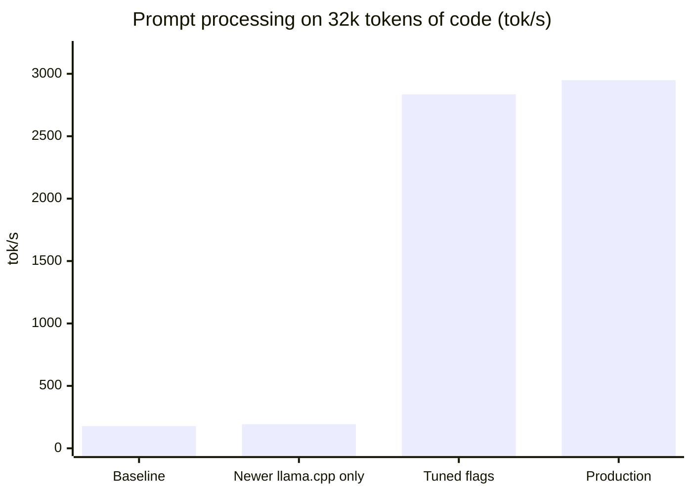
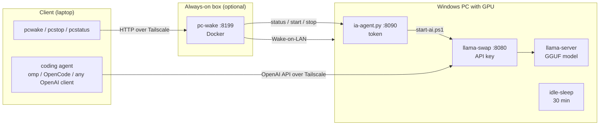

<p align="center">
  
</p>

<h1 align="center">local-llm-stack</h1>

<p align="center">
  <b>Run a 35B coding model on a 10 GB gaming GPU, use it from anywhere, and wake the PC only when you need it.</b>
</p>

<p align="center">
  
  
  
  
  
  
  
</p>

<p align="center">
  
  
  
</p>

---

## What this is

A small, opinionated toolkit that turns a Windows gaming PC into a **private, OpenAI-compatible LLM server** for coding agents:

- **Serve** one or more GGUF models through [llama.cpp](https://github.com/ggml-org/llama.cpp) behind [llama-swap](https://github.com/mostlygeek/llama-swap) (one URL, one API key, models loaded on demand).
- **Reach it from anywhere** over [Tailscale](https://tailscale.com), from any OpenAI-compatible client ([omp](https://github.com/can1357/oh-my-pi) and [OpenCode](https://opencode.ai) configs included).
- **Wake it on demand**: a tiny Docker service on an always-on box (NAS, Raspberry Pi, home server) sends Wake-on-LAN, then asks the PC to start the model if it isn't running. The PC goes back to sleep after 30 idle minutes.
- **No Windows service, no scheduled task**: you start the stack with one double-click, and it survives sleep.

It ships with a **reference configuration measured on real hardware** (RTX 3080 10 GB, Ryzen 7 3800X, 32 GB DDR4) and the full benchmark log behind every parameter, so you can see *why* each flag is there and re-tune it for your machine.

## Results on the reference machine

Measured by querying `llama-server` with real source code, median of 2 runs.

| | Starting point | Tuned | |
|---|---|---|---|
| Prompt processing, 32k tokens | 178 tok/s | **2,949 tok/s** | **16×** |
| Prompt processing, 64k tokens | spilled out of VRAM | **2,461 tok/s** | 64k read in ~27 s |
| Generation | 20–37 tok/s | **~50 tok/s** (MTP) | |
| Second turn of a conversation | re-reads 2,048 tokens (10–15 s) | **20 tokens in 0.27 s** | |
| Average agent request | 72 s | **46 s** | −36 % |
| Model load | ~71 s | **~20 s** | NVMe |



**What actually mattered**, in order:

1. **Not spilling out of VRAM.** With a MoE model partly on CPU, a `--n-cpu-moe` value one or two layers too low silently overflows into shared memory and divides speed by 10. This was the #1 problem.
2. **A recent llama.cpp build**: +51 to +67 % prompt processing at 32–64k.
3. **`-ub 4096`** (+41 %) and **`--load-mode none`** (+36 %).
4. **Q4_K instead of IQ4** quants when experts run on CPU: +40 % generation.
5. **MTP speculative decoding** (+5 to 20 % generation) and a **bounded reasoning budget** (−36 % time per agent request).

**No measurable effect**: Windows power plan, `-tb`, `--cache-reuse`, CUDA 13 vs 12, RAM/VRAM/GPU overclocking.

Every number, chart and dead end: [docs/BENCHMARKS.md](docs/BENCHMARKS.md).

---

## How it works



| Component | Where | Role | Required? |
|---|---|---|---|
| `llama-swap` + `llama-server` | PC | serves the models on one OpenAI-compatible endpoint, with an API key | **yes** |
| `start-ai.ps1` / `stop-ai.ps1` | PC | start/stop the stack; generate the llama-swap config and secrets | **yes** |
| `ia-agent.py` | PC | tiny HTTP agent with exactly 3 actions (`status`, `start`, `stop`), token-protected | only for remote start |
| `idle-sleep.ps1` | PC | puts the PC to sleep after N idle minutes | optional |
| `pc-wake` | NAS / Pi / server | Wake-on-LAN + "start the stack if it isn't running" | optional |
| `mac/install.sh` | client | configures omp, OpenCode and the `pcwake`/`pcstop`/`pcstatus` shell helpers, **never overwrites existing files** | optional |

A typical session from the client: `pcwake` → PC wakes up (or is already on) → the model is started if needed → your agent talks straight to llama-swap → you walk away → the PC sleeps 30 minutes later.

---

## Adapting it to your setup

The scripts are generic; the **numbers** in the llama-swap template are the only machine-specific part.

| Your situation | What to do |
|---|---|
| **Different GPU / VRAM** | Re-tune `--n-cpu-moe` (and possibly `-ub`) per model with `bench/bench.ps1`. Rule: the smallest value that leaves ~400–500 MB of VRAM free at peak, with your usual apps open. See [Tuning](#tuning-for-your-hardware). |
| **24 GB+ VRAM** | A 35B-A3B Q4 model (~20 GB) fits entirely on the GPU: drop `--n-cpu-moe` and expect much faster generation (not measured here). |
| **Different model** | Edit `pc/llama-swap/llama-swap.template.yaml`: file name, sampling (use the model card's recommended values), remove the MTP flags if the model has no MTP head. |
| **Dense model instead of MoE** | `--n-cpu-moe` doesn't apply; use `-ngl` to choose how many layers go on the GPU. A dense model that doesn't fit in VRAM will be slow (3.5 tok/s for a 27B here). |
| **No NAS / always-on box** | Skip `nas/`. Start the stack with `pc\Demarrer IA.bat` and keep the PC awake (`start-ai.ps1 -KeepAwakeHours N`, or set `idle_sleep_minutes` high). |
| **No Tailscale** | Set `"listen"` in `pc/stack.json` to a LAN IP or `127.0.0.1`. Don't expose port 8080 to the internet. |
| **Another client** (Continue, Aider, scripts…) | Any OpenAI-compatible client works: base URL `http://<pc>:8080/v1`, API key from `pc/secrets/llama-api-key.txt`, model name = a key of the llama-swap `models:` section. |
| **Linux / macOS server** | The PowerShell scripts are Windows-only, but the llama-swap template and all llama.cpp flags carry over as is. |
| **Linux client / bash** | `install.sh` works on Linux; the shell helpers are appended to `~/.zshrc`, so copy `mac/zshrc-ia.sh` into your `~/.bashrc` instead if you use bash. |

### Tuning for your hardware

Settings that **transfer as is** to any NVIDIA + partial CPU offload setup:

| Flag | Why |
|---|---|
| `--load-mode none` | without mmap, prompt processing is much faster once experts are on CPU |
| `-b 4096 -ub 4096` | large batches amortize copying CPU-side experts to the GPU (use 2048 if VRAM is tight) |
| `-ctk q8_0 -ctv q8_0` | same speed as f16, less VRAM, quality preserved |
| `-fa on` | flash attention |
| `-np 2 --checkpoint-min-step 2048` | agents: side requests (titles, sub-agents) don't evict the main conversation's cache |
| `--reasoning-budget 4000` | bounds thinking: shorter answers, faster agent loops |
| `CUDA_MODULE_LOADING=EAGER` | fixes `CUDA error: shared object initialization failed` at startup |
| Q4_K quants rather than IQ4 | faster when part of the model runs on CPU (+40 % generation here) |
| Models on NVMe | 3.5× faster loading |

Settings you **must re-measure**:

1. **`--n-cpu-moe`**: start high (e.g. 40 on 10 GB), lower it 1–2 at a time while `vram_max_mib` stays below *total VRAM − 500 MB* and prompt processing doesn't collapse (a 3× drop means overflow). MTP needs ~1.3 GB more (≈ 3–4 extra expert layers on CPU).
2. **`-t`**: try your physical core count, then −1, −2. Generation is RAM-bound; SMT made it 12 % slower here.
3. **MTP**: only if the GGUF really contains MTP layers; `--spec-draft-n-max 2`.
4. **Context**: 64k per conversation is plenty for one-task-per-session agents; for long sessions use `-c 262144 -np 2 --kv-unified` at the cost of a few more expert layers on CPU.

```powershell
.\bench\bench.ps1 -Label try-ncmoe34 -SkipBench -PromptSizes 32768 -Runs 1 -CodeDir C:\code\some-repo `
  -ServerArgs "-ngl 99 --n-cpu-moe 34 -c 131072 -np 2 -fa on -ctk q8_0 -ctv q8_0 -b 4096 -ub 4096 -t 6 --load-mode none"
```

`bench.ps1` uses a real code repository as prompt material, runs the real server, records peak VRAM and appends everything to `bench/results.csv`.

---

## Reference models

What the template serves on the reference machine (one model in VRAM at a time; switching takes ~20 s to 2 min):

| llama-swap name | Prompt processing @32k | Generation | Context per conversation | Use |
|---|---|---|---|---|
| `cybertiel` | ~2,950 tok/s | ~47 tok/s | 64k | fastest prompt processing |
| **`cybertiel-mtp`** | ~2,380 tok/s | **~50 tok/s** | 64k | **daily coding** |
| `cybertiel-262k` | ~2,440 tok/s | ~40 tok/s (32k → 128k) | **~250k** | long sessions |
| `heretic` | ~2,200 tok/s | ~47 tok/s | 64k | general use |

Models: [Cyber-Tiel Coder 35B-A3B](https://huggingface.co/peculiar-ragdoll/Cyber-Tiel-Coder-35B-A3B-GGUF-MTP) (`UD-Q4_K_S`) and Qwen3.6-35B-A3B heretic (`Q4_K_S`). Both are MoE models with ~3B active parameters, which is what makes a 35B usable with 10 GB of VRAM.

---

## Quick start

**1. PC (Windows + NVIDIA)**
1. Install llama.cpp (Windows CUDA release + cudart), llama-swap, Python 3 and Tailscale; download a GGUF model.
2. Copy `pc\stack.example.json` to `pc\stack.json` and fill in the paths.
3. Adapt `pc\llama-swap\llama-swap.template.yaml` to your models and VRAM.
4. Double-click `pc\Demarrer IA.bat` ("Start AI"). Secrets are generated in `pc\secrets\` on first run.

**2. Always-on box (optional)**
```bash
cd nas/pc-wake && cp .env.example .env   # PC MAC address, broadcast, PC Tailscale IP, agent token
docker compose up -d
```

**3. Client**
```bash
cd mac && ./install.sh <pc-tailscale-name> <nas-tailscale-name> ~/llama-key.txt
pcwake && omp --model pc/cybertiel-mtp
```

Full step-by-step guide, Wake-on-LAN setup included: [docs/INSTALL.md](docs/INSTALL.md).

### `pc/stack.json`

| Key | Meaning |
|---|---|
| `llama_server`, `llama_swap` | paths to the executables |
| `models_dir` | folder holding the GGUF files (`{{MODELS_DIR}}` in the template) |
| `opencode` | optional: path to `opencode.exe` to also run `opencode serve` (password-protected) |
| `pythonw` | Python used by the agent |
| `listen` | `"tailscale"` (PC's Tailscale IP) or a fixed IP |
| `llama_swap_port`, `agent_port`, `opencode_port` | 8080, 8090, 4096 by default |
| `idle_sleep_minutes` | sleep after N idle minutes |

---

## Repository layout

```
pc/
  stack.example.json                 machine config (copy to stack.json)
  Demarrer IA.bat / Arreter IA.bat   start / stop the stack
  llama-swap/llama-swap.template.yaml  models and every llama.cpp flag, commented
  scripts/                           start-ai, stop-ai, start-agent, ia-agent.py, idle-sleep, keep-awake
  opencode/AGENTS.md                 agent rules (Windows variant)
nas/pc-wake/                         docker-compose.yml + .env.example
mac/                                 install.sh, omp / OpenCode configs, AGENTS.md, shell helpers
bench/                               bench.ps1, results.csv (164 measurements), RESULTATS.md (raw report)
docs/                                BENCHMARKS, PARAMETRES (tuning), CAS-USAGE (use case), INSTALL
```

Generated and **never committed**: `pc/stack.json`, `pc/secrets/`, `pc/logs/`, `pc/llama-swap/llama-swap.yaml`, `nas/pc-wake/.env`.

## Security

| Service | Exposed on | Protection |
|---|---|---|
| llama-swap `:8080` | Tailscale IP only | API key |
| ia-agent `:8090` | Tailscale IP only | token; 3 fixed actions, no arbitrary commands |
| opencode serve `:4096` (optional) | Tailscale IP only | password |
| pc-wake `:8199` | tailnet + LAN | none: it can only wake the PC or stop the model |

The included `AGENTS.md` rules tell coding agents not to invent missing data, to stop and ask when information is missing, to test against real data, not to write outside the project and never to `git push` without asking. With a local model this mattered: it would otherwise fabricate inputs and write tests that validated them.

## Limitations

- After a **reboot**, nothing starts on its own (by design): run `Demarrer IA.bat`.
- Wake-on-LAN works from **sleep**; waking from shutdown needs BIOS support and Fast Startup disabled.
- `--n-cpu-moe` values are specific to 10 GB of VRAM.
- Model **quality** was checked on real coding tasks, not with a systematic benchmark.
- Scripts, comments and the detailed docs are in **French** for now; the flags, numbers and charts read the same in any language.

## Background

Why this exists, the constraints (Windows required for gaming, no WSL, nothing to buy, no hidden services) and the full tuning journey: [docs/CAS-USAGE.md](docs/CAS-USAGE.md) (French).

## License

[MIT](LICENSE). Models and third-party tools keep their own licenses.
