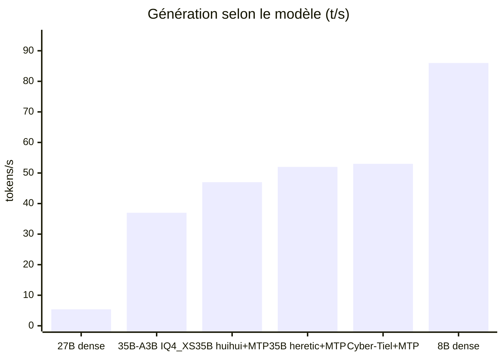
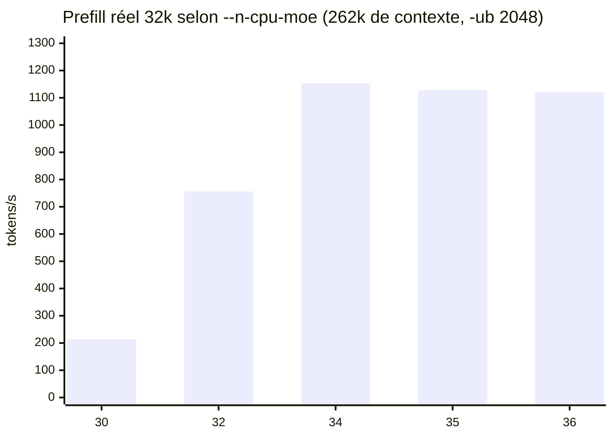
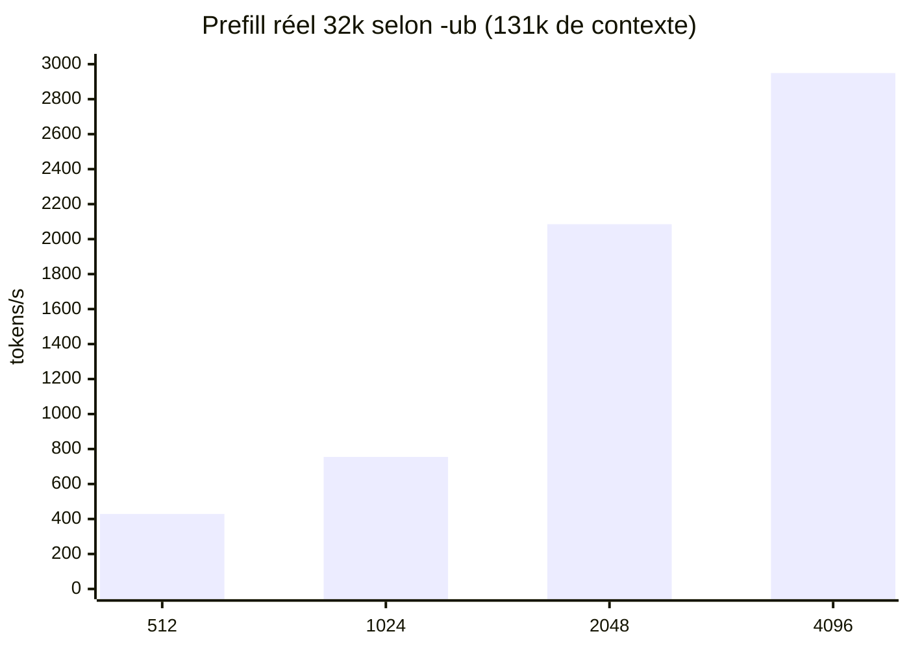
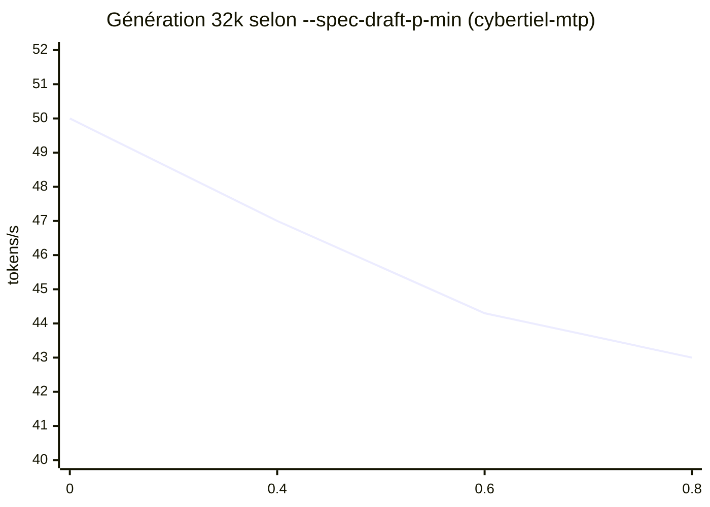
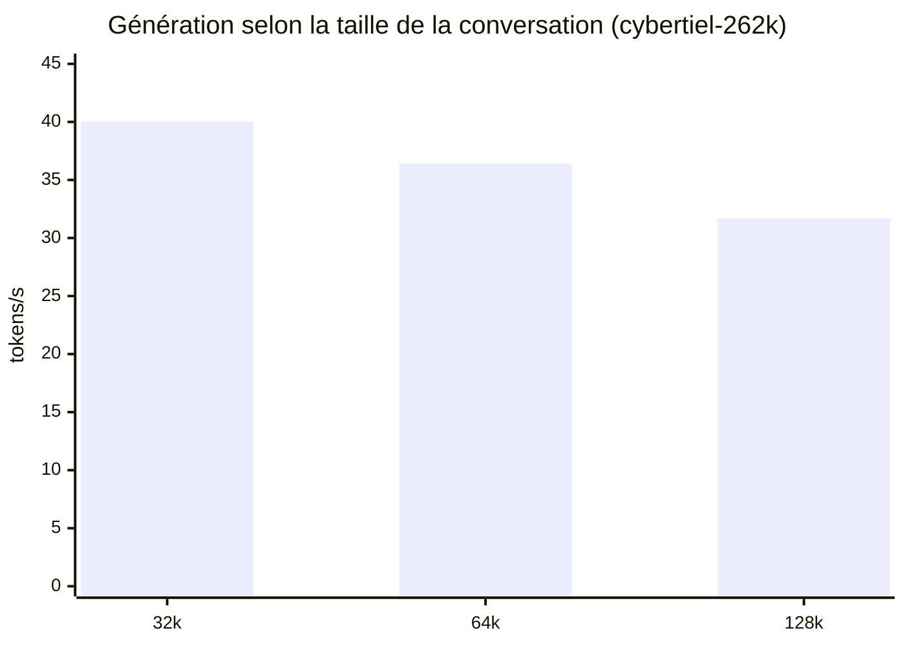

# Benchmarks : comment chaque paramètre a été choisi

Toutes les mesures ont été faites sur la même machine (voir [CAS-USAGE.md](CAS-USAGE.md)) :
**RTX 3080 10 Go · Ryzen 7 3800X (Zen 2, 8 cœurs) · 32 Go DDR4 dual channel · Windows 11 · NVMe Gen3**.

- **t/s** = tokens par seconde. **Prefill** = lecture du prompt / du contexte. **Génération** = écriture de la réponse.
- « llama-bench » = outil de mesure de llama.cpp (contexte réservé juste pour le test).
- « Serveur réel » = `llama-server` lancé avec la vraie config, interrogé avec du **vrai code** (8k, 32k, 64k tokens), comme le ferait un agent. C'est ce chiffre qui compte : llama-bench ne voit pas les débordements de VRAM liés au contexte réservé.
- Sauf mention, médiane de 2 passes (1 passe pour les balayages exploratoires). Données brutes : [`bench/results.csv`](../bench/results.csv) (164 lignes), rapport complet : [`bench/RESULTATS.md`](../bench/RESULTATS.md), script : [`bench/bench.ps1`](../bench/bench.ps1).

## Sommaire
1. [Résultat final](#1-résultat-final)
2. [Choix du modèle](#2-choix-du-modèle)
3. [Le piège n°1 : le débordement de VRAM](#3-le-piège-n1--le-débordement-de-vram)
4. [Version de llama.cpp](#4-version-de-llamacpp)
5. [Taille des lots (`-ub`)](#5-taille-des-lots--ub)
6. [Chargement du modèle (`--load-mode`)](#6-chargement-du-modèle---load-mode)
7. [Threads (`-t`, `-tb`)](#7-threads--t--tb)
8. [MTP (décodage spéculatif)](#8-mtp-décodage-spéculatif)
9. [Contexte : 64k, 131k ou 262k](#9-contexte--64k-131k-ou-262k)
10. [Cache KV](#10-cache-kv)
11. [Usage agent : emplacements, cache et budget de réflexion](#11-usage-agent--emplacements-cache-et-budget-de-réflexion)
12. [Fiabilité : `CUDA_MODULE_LOADING=EAGER`](#12-fiabilité--cuda_module_loadingeager)
13. [Ce qui n'a rien apporté](#13-ce-qui-na-rien-apporté)
14. [Qualité : tests de code réels](#14-qualité--tests-de-code-réels)

---

## 1. Résultat final

| Serveur réel | Départ | Final (`cybertiel`) | Final (`cybertiel-mtp`) |
|---|---|---|---|
| Prefill 8k | 214 t/s | **3 015 t/s** | 2 414 t/s |
| Prefill 32k | 178 t/s | **2 949 t/s** | 2 381 t/s |
| Prefill 64k | débordement | **2 461 t/s** | 2 029 t/s |
| Génération 8k / 32k | 20 / — t/s | 49,0 / 46,6 t/s | **50,7 / 50,0 t/s** |
| 2e tour d'une conversation | 2 048 tokens relus en 10-15 s | **20 tokens relus en 0,27 s** | idem |
| Chargement du modèle | ~71 s (SATA) | **~20 s** (NVMe) | ~20 s |

---

## 2. Choix du modèle

Contrainte : 10 Go de VRAM. Un modèle **dense** doit tenir entièrement en VRAM pour être rapide ; un **MoE** (beaucoup de paramètres, peu actifs par token) peut garder ses « experts » en RAM.

Mesures (llama.cpp b12004, réglages par défaut ou proches) :

| Modèle | Type | Fichier | Génération | Verdict |
|---|---|---|---|---|
| Qwen3.8-27B (variante MTP) IQ4_XS | dense 27B | 17,0 Go | **3,5 t/s** (5,4 avec MTP) | ❌ trop gros pour 10 Go : moitié sur CPU |
| Qwen3.6-35B-A3B UD-IQ4_XS | MoE, 3B actifs | 17,7 Go | 32-38 t/s | format IQ lent sur CPU |
| Qwen3.8-35B-A3B Distill APEX (abliterated) | MoE | 14,7 Go | 45-51 t/s | pas de couches MTP malgré le nom |
| Qwen3.6-35B-A3B abliterated (huihui) Q4_K | MoE | 21,7 Go | 38 → 47 t/s (MTP) | correct, un peu plus lent |
| Qwen3.6-35B-A3B heretic Q4_K_S | MoE + MTP | 20,4 Go | 40 → **51-54 t/s** (MTP) | ✅ meilleur généraliste |
| **Cyber-Tiel Coder 35B-A3B Q4_K_S** (Ornith 1.5) | MoE + MTP | 21,3 Go | 53 → ~50-60 t/s (MTP) | ✅ **retenu pour le code** (SWE-bench Verified 79 annoncé par l'éditeur d'Ornith) |
| TwIL-8B Q4_K_M | dense 8B (tout en VRAM) | 5,35 Go | **82-90 t/s** | ❌ rapide mais code cassé en projet réel (§14) |

**Q4_K plutôt qu'IQ4** : à modèle égal, IQ4_XS plafonne à ~40 t/s contre ~55 t/s en Q4_K_S (même réglages). Les formats « IQ » demandent plus de calcul pour décompresser les poids, ce qui pèse sur la partie CPU (les experts).

---

## 3. Le piège n°1 : le débordement de VRAM

Avec un MoE, `-ngl 99 --n-cpu-moe N` met tout sur le GPU **sauf les experts des N premières couches**. Plus N est petit, plus c'est rapide… jusqu'à ce que la VRAM soit pleine : Windows bascule alors silencieusement sur la RAM système (« sysmem fallback ») et **tout s'effondre**.

| `--n-cpu-moe` (262k, `-ub 2048`) | VRAM max | Prefill 32k | Génération |
|---|---|---|---|
| 30 | 10 001 Mo ❌ | 214 | 45,3 |
| 32 | 9 930 Mo ⚠️ | 756 | 43,2 |
| **34** | 9 914 Mo | **1 154** | 42,2 |
| 36 | 9 079 Mo | 1 121 | 41,3 |

Même chose en génération (llama-bench, 4k de contexte, b12004) : `-ncmoe 24` = 54 t/s, mais `-ncmoe 18-22` = **20-27 t/s** (débordement).

**Règle retenue** : le plus petit `--n-cpu-moe` qui laisse **~400-500 Mo de VRAM libre** au pic, **avec tes applis habituelles ouvertes** (navigateur, Discord… prennent 0,5 à 1 Go). Le lanceur de départ (`-c 262144 -ub 2048 --n-cpu-moe 28`) débordait : c'est l'essentiel du ×16.

---

## 4. Version de llama.cpp

Mêmes paramètres, llama-bench, prefill de 2 048 tokens à différentes profondeurs de contexte :

| Prefill (t/s) | b12004 | b12128 CUDA 12.4 | b12128 CUDA 13.4 |
|---|---|---|---|
| 0 | 813 | 777 | 1 366 |
| 16k | 928 | **1 554** | 1 444 |
| 32k | 891 | **1 485 (+67 %)** | 1 456 |
| 64k | 814 | **1 230 (+51 %)** | 1 211 |

Génération : identique (±1 t/s). CUDA 12.4 et 13.4 équivalents → **b12128 CUDA 12.4** retenu.

---

## 5. Taille des lots (`-ub`)

Quand des experts sont sur le CPU, llama.cpp copie leurs poids sur le GPU **une fois par lot** : de gros lots amortissent cette copie.

| `-ub` | Prefill 32k | Génération | VRAM | Remarque |
|---|---|---|---|---|
| 512 | 429 | 44,4 | 9 090 | |
| 1024 | 755 | — | 9 242 | |
| 2048 | 2 085 | 46,7 | 8 751 | 2 passes |
| **4096** | **2 949** | 46,6 | 9 363 | 2 passes, **+41 %** vs 2048 |

512 et 1024 : `--n-cpu-moe 30`, 1 passe ; 2048 et 4096 : `--n-cpu-moe 32`, 2 passes (même config de production).
⚠️ Un plus gros lot prend plus de VRAM : il a fallu monter `--n-cpu-moe` de 30 à 32 pour rester dans les clous. Le gain de prefill dépasse largement la petite perte de génération.

---

## 6. Chargement du modèle (`--load-mode`)

| `--load-mode` (2 passes) | Prefill 8k | Prefill 32k | Génération | Chargement |
|---|---|---|---|---|
| mmap (≈ défaut) | 1 336 | 2 174 | 48,5 / 46,2 | 8 s |
| **none** | **3 015** | **2 949** | 49,0 / 46,6 | 16 s |

**+36 % à 32k, ×2,3 à 8k.** llama.cpp le conseille lui-même dans ses journaux quand des experts sont sur CPU (*« tensor overrides to CPU are used with mmap enabled - consider using --load-mode none »*). Coût : chargement un peu plus long.

---

## 7. Threads (`-t`, `-tb`)

| Réglage | Prefill 32k | Génération |
|---|---|---|
| -t 8 | 1 629 | 38,7 |
| **-t 6** | 1 604 | **39,5** |
| -t 7 | 1 605 | 39,3 |
| -t 16 | 1 629 | 34,7 (−12 %) |
| -t 6 -tb 8 | 1 610 | 39,5 |
| -t 6 -tb 16 | 1 570 | 38,9 |

La génération est limitée par la **bande passante RAM** (experts sur CPU), pas par le calcul : 6 threads suffisent, 16 (SMT) gênent. `-tb` n'apporte rien.

---

## 8. MTP (décodage spéculatif)

Le modèle contient une petite tête « MTP » qui **devine les tokens suivants** ; le modèle principal les vérifie en un seul passage. Le texte produit est le même, seulement plus vite… si la VRAM le permet (le MTP coûte ~1,3 Go).

**Nombre de tokens devinés** (`--spec-draft-n-max`, b12004) : 2 → 50,6 t/s · **3 → 51,5 t/s** · 6 → 37-49 t/s. Sur cette machine, 2-3 est optimal (2 retenu : plus stable quand des experts sont sur CPU).

**Seuil de confiance** (`--spec-draft-p-min`, 2 passes) :

| p-min | Génération 8k / 32k | Acceptation |
|---|---|---|
| **0** | **50,7 / 50,0** | 67-71 % |
| 0,4 | 48,7 / 47,0 | 77 % |
| 0,6 | 45,8 / 44,3 | 82-87 % |
| 0,8 | 42,6 / 43,0 | 93 % |

Un seuil élevé accepte mieux mais **propose moins** : plus lent. **p-min = 0** (défaut) retenu.

**MTP + 262k = impossible ici** : avec 262k de contexte, toutes les configs MTP testées (`--n-cpu-moe` 38 à 41, cache du MTP en q8, petit lot) débordent (9,9-10 Go, prefill effondré). D'où deux variantes : `cybertiel-mtp` (64k) et `cybertiel-262k` (sans MTP).

---

## 9. Contexte : 64k, 131k ou 262k

Le cache de ce modèle hybride est petit (quelques couches d'attention seulement), mais chaque tranche de contexte réservée coûte de la VRAM, donc des experts en plus sur CPU.

| Config | Prefill 32k / 64k / 128k | Génération 32k / 64k / 128k | VRAM |
|---|---|---|---|
| 131k (2 × 64k), `-ncmoe 32` | 2 949 / 2 461 / — | 46,6 / 39,2 / — | 9,4-9,7 Go |
| **262k partagé** (`--kv-unified`), `-ncmoe 38` | 2 440 / 2 178 / **1 879** | 40,0 / 36,4 / **31,7** | 9,8 Go |

Test réel : une conversation de **97 000 tokens** lue à 1 982 t/s, génération 34,7 t/s.

---

## 10. Cache KV

| Cache KV (16k de contexte) | Prefill | Génération |
|---|---|---|
| f16 / f16 | 910 | 50,5 |
| q8_0 / q8_0 | 817-1 092 | 52,7 |

Pas de différence mesurable de vitesse → **q8_0** (moins de VRAM). Jamais en dessous de q8 (qualité).

---

## 11. Usage agent : emplacements, cache et budget de réflexion

Mesuré sur les **journaux réels** de sessions OpenCode (requêtes de l'agent) :

| Config | Requêtes | Temps passé à relire | Génération | Réponse moyenne | Durée moyenne / requête |
|---|---|---|---|---|---|
| 1 emplacement, réflexion 8 000 | 37 | **19 %** | 50,0 t/s | 966 tokens | (tâches plus courtes) |
| 2 emplacements (`-np 2`), réflexion 8 000 | 17 | 12 % | 48,5 t/s | 3 074 tokens | 72 s |
| **2 emplacements, réflexion 4 000** | 28 | 12-14 % | 47,3 t/s | **1 854 tokens** | **46 s (−36 %)** |

- **`-np 2`** : l'agent envoie des requêtes annexes (titres, sous-agents, résumés). Avec un seul emplacement, chacune **écrase le cache** de la session principale → relecture complète (jusqu'à 51 000 tokens en 41 s). Avec 2 emplacements, la session principale garde son cache.
- **`--reasoning-budget 4000`** : la réflexion est bornée ; les réponses raccourcissent de 40 % et chaque requête prend 36 % de temps en moins. Effet sur la justesse non mesuré.
- **`--checkpoint-min-step 2048`** : ce modèle hybride ne peut reprendre un prompt qu'à partir de « points de reprise » ; les rapprocher limite la relecture.
- Avec tout ça, en usage réel, **la génération représente ~85 % du temps** → c'est elle qu'il faut accélérer en priorité pour un agent (d'où le MTP).

---

## 12. Fiabilité : `CUDA_MODULE_LOADING=EAGER`

Symptôme : au changement de modèle, `CUDA error: shared object initialization failed` (dans `ggml_cuda_kernel_can_use_pdl`), surtout avec le MTP.

| Test (config MTP) | Démarrages réussis |
|---|---|
| b12128 CUDA 12.4 | 0 / 4 |
| b12128 CUDA 13.4 | 1 / 4 |
| b12004 (ancienne) | 0 / 4 |
| `--n-cpu-moe 40` (3 Go de VRAM libre) | 1 / 4 → pas un manque de VRAM |
| `GGML_CUDA_PDL=0` | toujours des échecs |
| **`CUDA_MODULE_LOADING=EAGER`** | **4 / 4**, puis **7 / 7 changements de modèle via llama-swap** |

Le pilote charge le code des fonctions CUDA à la demande ; ce chargement échouait au démarrage du contexte MTP. En mode « eager » tout est chargé au démarrage : même vitesse, ~+400 Mo de VRAM, quelques secondes de chargement en plus.

---

## 13. Ce qui n'a rien apporté

| Essai | Résultat |
|---|---|
| Plan d'alimentation (Ryzen Balanced / High Performance / Ultimate) | < 2 % (bruit) |
| `-tb` (threads de lot) | 0 % |
| `--cache-reuse` 0 / 256 / 512 | 0 % (le modèle hybride passe par les points de reprise) |
| CUDA 13.4 vs 12.4 | équivalent |
| Seuil MTP > 0 | −6 à −15 % |
| OC RAM 3200 → 3600 (FCLK 1:1) | pas de gain mesurable |
| OC VRAM | pas de gain mesurable |
| OC du cœur GPU | **plantages du pilote** (nvlddmkm) sous charge CUDA, alors que les benchs 3D passaient |
| Modèle sur SATA vs NVMe | génération identique, mais chargement 71 s vs ~17-20 s |

---

## 14. Qualité : tests de code réels

Vitesse ≠ qualité. Deux tests « from scratch » (même énoncé : un jeu de blocs qui tombent en HTML, et un bac à sable voxel 3D en three.js) :

| Modèle | Temps | Résultat |
|---|---|---|
| TwIL-8B (réflexion) | 2 min 55 / 1 min 23 | ❌ jeu de blocs : erreur de syntaxe, puis plusieurs plantages logiques ; voxel : fige le navigateur, terrain à l'envers |
| Cyber-Tiel (réflexion illimitée) | coupé à 30 000 tokens | ❌ aucune réponse : il réécrit tout le code dans sa réflexion |
| Cyber-Tiel (sans réflexion) | 1 min 25 / 1 min 40 | ⚠️ bugs simples (ordre d'appel, argument oublié) ; jeu 3D fonctionnel après 2 corrections d'une ligne (144 FPS) |
| Cyber-Tiel (réflexion bornée à 8 000) | 4 min 41 | réponse complète (655 lignes) |

Et sur un projet réel piloté en agent (une petite app Rust) : code propre, mais **des données inventées** (fichier de config deviné au lieu de lu) validées par des tests eux aussi inventés. Corrigé par des règles explicites ([`mac/AGENTS.md`](../mac/AGENTS.md)) : sur un test piège (lire un fichier inexistant), l'agent est passé de « invente une solution de repli » à « s'arrête et demande ».
