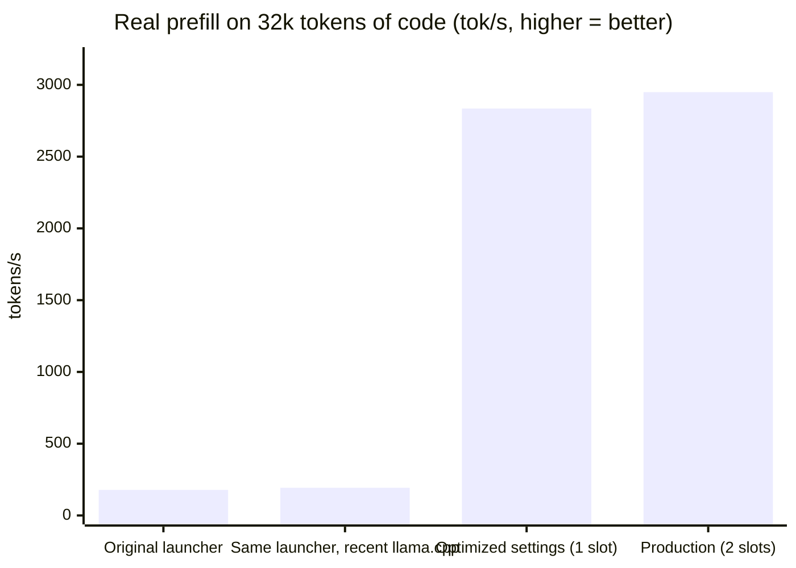
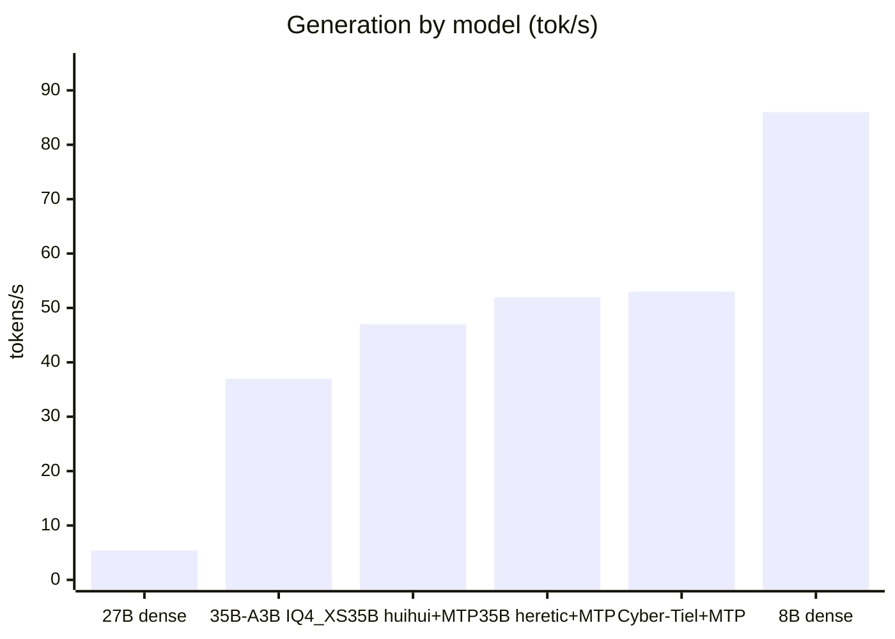
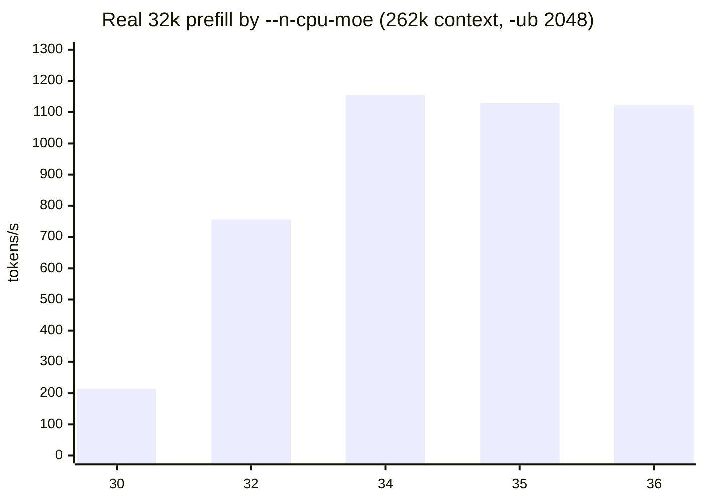
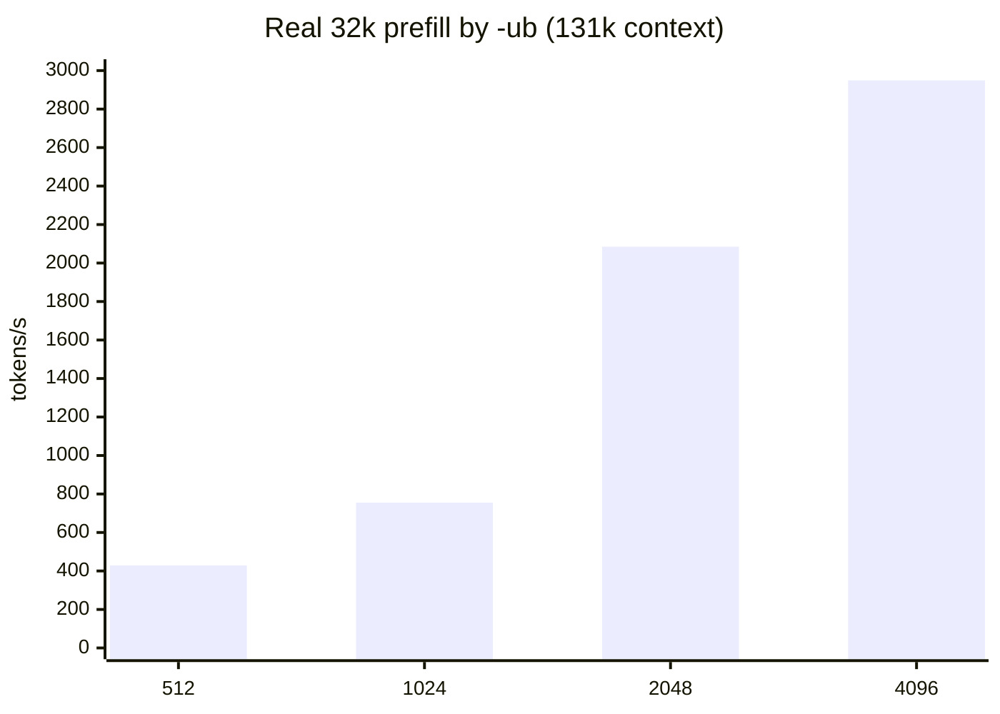
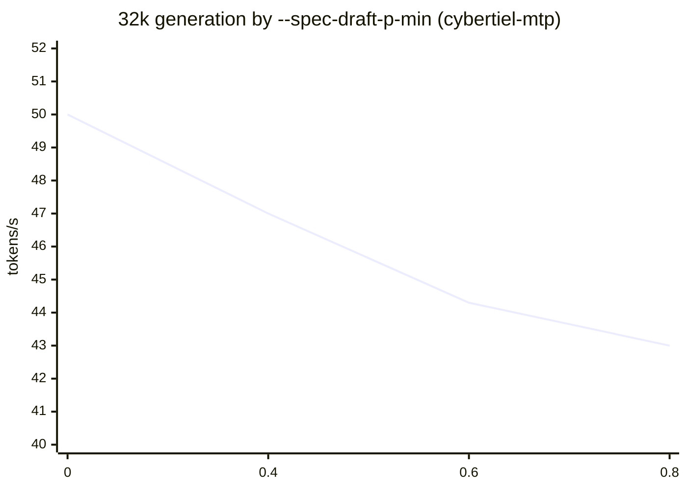
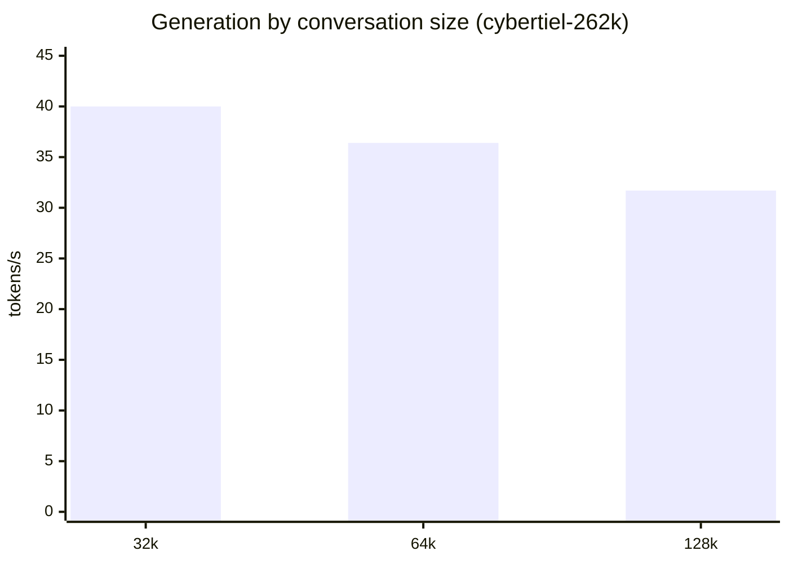

# Benchmarks: how each parameter was chosen

All measurements were taken on the same machine (see [USE-CASE.md](USE-CASE.md)):
**RTX 3080 10 GB · Ryzen 7 3800X (Zen 2, 8 cores) · 32 GB DDR4 dual channel · Windows 11 · NVMe Gen3**.

- **tok/s** = tokens per second. **Prefill** = reading the prompt / context. **Generation** = writing the response.
- "llama-bench" = llama.cpp's measurement tool (context reserved just for the test).
- "Real server" = `llama-server` launched with the actual config, queried with **real code** (8k, 32k, 64k tokens), the way an agent would. This is the number that matters: llama-bench does not see VRAM overflows caused by the reserved context.
- Unless noted otherwise, median of 2 runs (1 run for exploratory sweeps). Raw data: [`bench/results.csv`](../bench/results.csv) (164 rows), full report: [`bench/REPORT.md`](../bench/REPORT.md), script: [`bench/bench.ps1`](../bench/bench.ps1).

## Contents
1. [Final result](#1-final-result)
2. [Model choice](#2-model-choice)
3. [Pitfall #1: VRAM overflow](#3-pitfall-1-vram-overflow)
4. [llama.cpp version](#4-llamacpp-version)
5. [Batch size (`-ub`)](#5-batch-size--ub)
6. [Model loading (`--load-mode`)](#6-model-loading---load-mode)
7. [Threads (`-t`, `-tb`)](#7-threads--t--tb)
8. [MTP (speculative decoding)](#8-mtp-speculative-decoding)
9. [Context: 64k, 131k or 262k](#9-context-64k-131k-or-262k)
10. [KV cache](#10-kv-cache)
11. [Agent usage: slots, cache and reasoning budget](#11-agent-usage-slots-cache-and-reasoning-budget)
12. [Reliability: `CUDA_MODULE_LOADING=EAGER`](#12-reliability-cuda_module_loadingeager)
13. [What did not help](#13-what-did-not-help)
14. [Quality: real-world coding tests](#14-quality-real-world-coding-tests)

---

## 1. Final result

| Real server | Original | Final (`cybertiel`) | Final (`cybertiel-mtp`) |
|---|---|---|---|
| Prefill 8k | 214 tok/s | **3,015 tok/s** | 2,414 tok/s |
| Prefill 32k | 178 tok/s | **2,949 tok/s** | 2,381 tok/s |
| Prefill 64k | overflow | **2,461 tok/s** | 2,029 tok/s |
| Generation 8k / 32k | 20 / — tok/s | 49.0 / 46.6 tok/s | **50.7 / 50.0 tok/s** |
| 2nd turn of a conversation | 2,048 tokens re-read in 10-15 s | **20 tokens re-read in 0.27 s** | same |
| Model loading | ~71 s (SATA) | **~20 s** (NVMe) | ~20 s |

---

## 2. Model choice

Constraint: 10 GB of VRAM. A **dense** model must fit entirely in VRAM to be fast; a **MoE** (many parameters, few active per token) can keep its "experts" in RAM.

Measurements (llama.cpp b12004, default or near-default settings):

| Model | Type | File | Generation | Verdict |
|---|---|---|---|---|
| Qwen3.8-27B (MTP variant) IQ4_XS | dense 27B | 17.0 GB | **3.5 tok/s** (5.4 with MTP) | ❌ too large for 10 GB: half on CPU |
| Qwen3.6-35B-A3B UD-IQ4_XS | MoE, 3B active | 17.7 GB | 32-38 tok/s | IQ format slow on CPU |
| Qwen3.8-35B-A3B Distill APEX (abliterated) | MoE | 14.7 GB | 45-51 tok/s | no MTP layers despite the name |
| Qwen3.6-35B-A3B abliterated (huihui) Q4_K | MoE | 21.7 GB | 38 → 47 tok/s (MTP) | decent, slightly slower |
| Qwen3.6-35B-A3B heretic Q4_K_S | MoE + MTP | 20.4 GB | 40 → **51-54 tok/s** (MTP) | ✅ best general-purpose model |
| **Cyber-Tiel Coder 35B-A3B Q4_K_S** (Ornith 1.5) | MoE + MTP | 21.3 GB | 53 → ~50-60 tok/s (MTP) | ✅ **chosen for code** (SWE-bench Verified 79 claimed by Ornith's publisher) |
| TwIL-8B Q4_K_M | dense 8B (fully in VRAM) | 5.35 GB | **82-90 tok/s** | ❌ fast but broken code on a real project (§14) |

**Q4_K rather than IQ4**: for the same model, IQ4_XS tops out at ~40 tok/s versus ~55 tok/s with Q4_K_S (same settings). "IQ" formats require more computation to decompress the weights, which weighs on the CPU side (the experts).

---

## 3. Pitfall #1: VRAM overflow

With a MoE, `-ngl 99 --n-cpu-moe N` puts everything on the GPU **except the experts of the first N layers**. The smaller N is, the faster it runs… until VRAM is full: Windows then silently falls back to system RAM ("sysmem fallback") and **everything collapses**.

| `--n-cpu-moe` (262k, `-ub 2048`) | Peak VRAM | Prefill 32k | Generation |
|---|---|---|---|
| 30 | 10,001 MB ❌ | 214 | 45.3 |
| 32 | 9,930 MB ⚠️ | 756 | 43.2 |
| **34** | 9,914 MB | **1,154** | 42.2 |
| 36 | 9,079 MB | 1,121 | 41.3 |

Same story for generation (llama-bench, 4k context, b12004): `-ncmoe 24` = 54 tok/s, but `-ncmoe 18-22` = **20-27 tok/s** (overflow).

**Rule adopted**: the smallest `--n-cpu-moe` that leaves **~400-500 MB of free VRAM** at peak, **with your usual apps open** (browser, Discord… take 0.5 to 1 GB). The original launcher (`-c 262144 -ub 2048 --n-cpu-moe 28`) was overflowing: that accounts for most of the ×16.

---

## 4. llama.cpp version

Same parameters, llama-bench, 2,048-token prefill at various context depths:

| Prefill (tok/s) | b12004 | b12128 CUDA 12.4 | b12128 CUDA 13.4 |
|---|---|---|---|
| 0 | 813 | 777 | 1,366 |
| 16k | 928 | **1,554** | 1,444 |
| 32k | 891 | **1,485 (+67%)** | 1,456 |
| 64k | 814 | **1,230 (+51%)** | 1,211 |

Generation: identical (±1 tok/s). CUDA 12.4 and 13.4 are equivalent → **b12128 CUDA 12.4** chosen.

---

## 5. Batch size (`-ub`)

When experts are on the CPU, llama.cpp copies their weights to the GPU **once per batch**: large batches amortize this copy.

| `-ub` | Prefill 32k | Generation | VRAM | Note |
|---|---|---|---|---|
| 512 | 429 | 44.4 | 9,090 | |
| 1024 | 755 | — | 9,242 | |
| 2048 | 2,085 | 46.7 | 8,751 | 2 runs |
| **4096** | **2,949** | 46.6 | 9,363 | 2 runs, **+41%** vs 2048 |

512 and 1024: `--n-cpu-moe 30`, 1 run; 2048 and 4096: `--n-cpu-moe 32`, 2 runs (same production config).
⚠️ A larger batch uses more VRAM: `--n-cpu-moe` had to be raised from 30 to 32 to stay within budget. The prefill gain far outweighs the small generation loss.

---

## 6. Model loading (`--load-mode`)

| `--load-mode` (2 runs) | Prefill 8k | Prefill 32k | Generation | Loading |
|---|---|---|---|---|
| mmap (≈ default) | 1,336 | 2,174 | 48.5 / 46.2 | 8 s |
| **none** | **3,015** | **2,949** | 49.0 / 46.6 | 16 s |

**+36% at 32k, ×2.3 at 8k.** llama.cpp itself recommends it in its logs when experts are on the CPU (*"tensor overrides to CPU are used with mmap enabled - consider using --load-mode none"*). Cost: slightly longer loading.

---

## 7. Threads (`-t`, `-tb`)

| Setting | Prefill 32k | Generation |
|---|---|---|
| -t 8 | 1,629 | 38.7 |
| **-t 6** | 1,604 | **39.5** |
| -t 7 | 1,605 | 39.3 |
| -t 16 | 1,629 | 34.7 (−12%) |
| -t 6 -tb 8 | 1,610 | 39.5 |
| -t 6 -tb 16 | 1,570 | 38.9 |

Generation is limited by **RAM bandwidth** (experts on CPU), not by compute: 6 threads are enough, 16 (SMT) hurt. `-tb` brings nothing.

---

## 8. MTP (speculative decoding)

The model contains a small "MTP" head that **guesses the next tokens**; the main model verifies them in a single pass. The output text is the same, just faster… if VRAM allows it (MTP costs ~1.3 GB).

**Number of guessed tokens** (`--spec-draft-n-max`, b12004): 2 → 50.6 tok/s · **3 → 51.5 tok/s** · 6 → 37-49 tok/s. On this machine, 2-3 is optimal (2 chosen: more stable when experts are on CPU).

**Confidence threshold** (`--spec-draft-p-min`, 2 runs):

| p-min | Generation 8k / 32k | Acceptance |
|---|---|---|
| **0** | **50.7 / 50.0** | 67-71% |
| 0.4 | 48.7 / 47.0 | 77% |
| 0.6 | 45.8 / 44.3 | 82-87% |
| 0.8 | 42.6 / 43.0 | 93% |

A higher threshold accepts more but **proposes less**: slower. **p-min = 0** (default) chosen.

**MTP + 262k = impossible here**: with 262k of context, every MTP config tested (`--n-cpu-moe` 38 to 41, MTP cache in q8, small batch) overflows (9.9-10 GB, collapsed prefill). Hence two variants: `cybertiel-mtp` (64k) and `cybertiel-262k` (no MTP).

---

## 9. Context: 64k, 131k or 262k

This hybrid model's cache is small (only a few attention layers), but every chunk of reserved context costs VRAM, and therefore more experts on CPU.

| Config | Prefill 32k / 64k / 128k | Generation 32k / 64k / 128k | VRAM |
|---|---|---|---|
| 131k (2 × 64k), `-ncmoe 32` | 2,949 / 2,461 / — | 46.6 / 39.2 / — | 9.4-9.7 GB |
| **262k shared** (`--kv-unified`), `-ncmoe 38` | 2,440 / 2,178 / **1,879** | 40.0 / 36.4 / **31.7** | 9.8 GB |

Real-world test: a **97,000-token** conversation read at 1,982 tok/s, generation 34.7 tok/s.

---

## 10. KV cache

| KV cache (16k context) | Prefill | Generation |
|---|---|---|
| f16 / f16 | 910 | 50.5 |
| q8_0 / q8_0 | 817-1,092 | 52.7 |

No measurable speed difference → **q8_0** (less VRAM). Never below q8 (quality).

---

## 11. Agent usage: slots, cache and reasoning budget

Measured on the **real logs** of OpenCode sessions (agent requests):

| Config | Requests | Time spent re-reading | Generation | Average response | Average duration / request |
|---|---|---|---|---|---|
| 1 slot, reasoning 8,000 | 37 | **19%** | 50.0 tok/s | 966 tokens | (shorter tasks) |
| 2 slots (`-np 2`), reasoning 8,000 | 17 | 12% | 48.5 tok/s | 3,074 tokens | 72 s |
| **2 slots, reasoning 4,000** | 28 | 12-14% | 47.3 tok/s | **1,854 tokens** | **46 s (−36%)** |

- **`-np 2`**: the agent sends side requests (titles, sub-agents, summaries). With a single slot, each one **overwrites the cache** of the main session → full re-read (up to 51,000 tokens in 41 s). With 2 slots, the main session keeps its cache.
- **`--reasoning-budget 4000`**: reasoning is capped; responses get 40% shorter and each request takes 36% less time. Effect on correctness not measured.
- **`--checkpoint-min-step 2048`**: this hybrid model can only resume a prompt from "checkpoints"; placing them closer together limits re-reading.
- With all of this, in real use, **generation accounts for ~85% of the time** → that is what to speed up first for an agent (hence MTP).

---

## 12. Reliability: `CUDA_MODULE_LOADING=EAGER`

Symptom: when switching models, `CUDA error: shared object initialization failed` (in `ggml_cuda_kernel_can_use_pdl`), especially with MTP.

| Test (MTP config) | Successful starts |
|---|---|
| b12128 CUDA 12.4 | 0 / 4 |
| b12128 CUDA 13.4 | 1 / 4 |
| b12004 (older) | 0 / 4 |
| `--n-cpu-moe 40` (3 GB of free VRAM) | 1 / 4 → not a VRAM shortage |
| `GGML_CUDA_PDL=0` | still failing |
| **`CUDA_MODULE_LOADING=EAGER`** | **4 / 4**, then **7 / 7 model switches via llama-swap** |

The driver loads CUDA function code on demand; this loading was failing when the MTP context started. In "eager" mode everything is loaded at startup: same speed, ~+400 MB of VRAM, a few extra seconds of loading.

---

## 13. What did not help

| Attempt | Result |
|---|---|
| Power plan (Ryzen Balanced / High Performance / Ultimate) | < 2% (noise) |
| `-tb` (batch threads) | 0% |
| `--cache-reuse` 0 / 256 / 512 | 0% (the hybrid model goes through checkpoints) |
| CUDA 13.4 vs 12.4 | equivalent |
| MTP threshold > 0 | −6 to −15% |
| RAM OC 3200 → 3600 (FCLK 1:1) | no measurable gain |
| VRAM OC | no measurable gain |
| GPU core OC | **driver crashes** (nvlddmkm) under CUDA load, even though 3D benchmarks passed |
| Model on SATA vs NVMe | identical generation, but loading 71 s vs ~17-20 s |

---

## 14. Quality: real-world coding tests

Speed ≠ quality. Two "from scratch" tests (same prompt: a falling-blocks game in HTML, and a 3D voxel sandbox in three.js):

| Model | Time | Result |
|---|---|---|
| TwIL-8B (reasoning) | 2 min 55 / 1 min 23 | ❌ blocks game: syntax error, then several logic crashes; voxel: freezes the browser, terrain upside down |
| Cyber-Tiel (unlimited reasoning) | cut off at 30,000 tokens | ❌ no answer: it rewrites all the code in its reasoning |
| Cyber-Tiel (no reasoning) | 1 min 25 / 1 min 40 | ⚠️ simple bugs (call order, missing argument); 3D game working after 2 one-line fixes (144 FPS) |
| Cyber-Tiel (reasoning capped at 8,000) | 4 min 41 | complete answer (655 lines) |

And on a real project driven as an agent (a small Rust app): clean code, but **made-up data** (config file guessed instead of read) validated by tests that were made up as well. Fixed with explicit rules ([`client/AGENTS.md`](../client/AGENTS.md)): on a trap test (reading a nonexistent file), the agent went from "invents a fallback" to "stops and asks".
